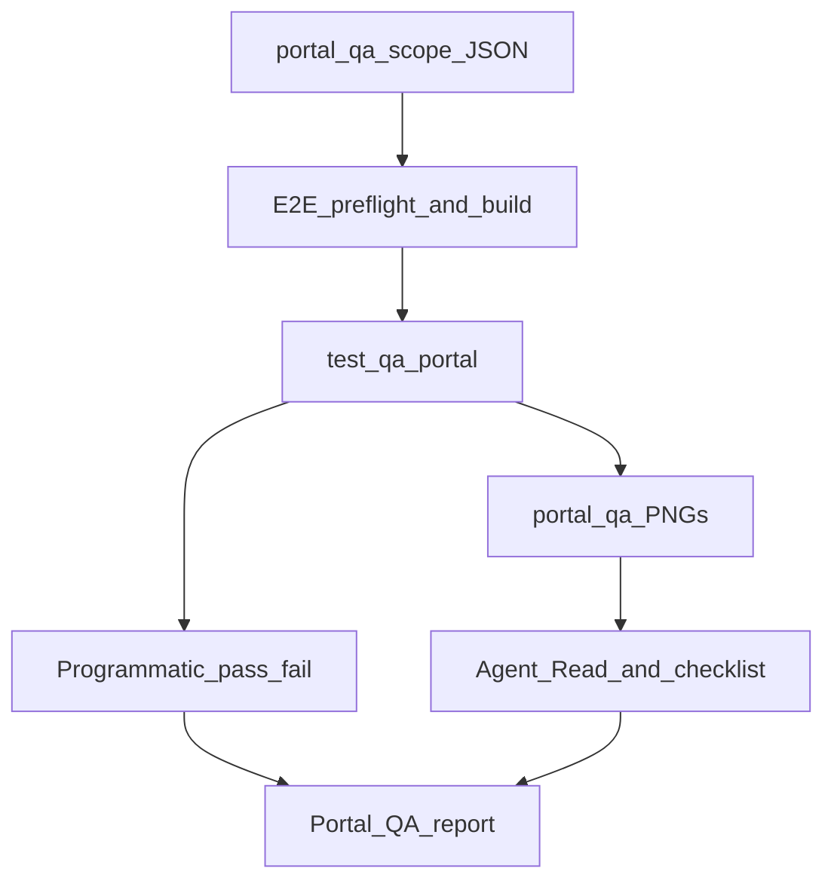

# Portal QA (on-demand, web)

Branch-scoped **visual and layout QA** for school portals (parent, teacher, school admin). Runs against **local E2E only** (Supabase seed, port 3100) — never production.

## Quick start

1. **Read this skill** when the user names `portal-qa` or asks to QA portal UI on the current branch.

2. **Determine scope** (ask only if ambiguous):

   | Case | Scope |
   |------|--------|
   | Default | Commits on current checkout vs `origin/main` |
   | User names another base | `HEAD` vs that base |
   | `include uncommitted` | Also working tree + staged paths |

3. **Run scope** (read-only):

   ```bash
   npm run portal-qa:scope
   # optional: npm run portal-qa:scope -- --base develop --uncommitted
   ```

   Parse JSON stdout: `scenarios`, `triggers`, `expandedToGolden`. If `scenarios` is empty, ask whether to run a **full golden sweep** (`PORTAL_QA_SCENARIOS=all`).

4. **Preflight** — follow [e2e-local](../e2e-local/SKILL.md):
   - Docker + `supabase status`
   - `.env.e2e.local` present
   - `npm run test:e2e:build` when app code changed on the branch

5. **Capture** — run Playwright for scoped scenarios:

   ```bash
   PORTAL_QA_SCENARIOS=committee-messages,parent-billing npm run test:qa:portal
   # all parent catalog (main + committees + co-op + notifications):
   PORTAL_QA_SCENARIOS=parent-all npm run test:qa:portal
   # all teacher catalog (full TeacherFeatures on E2E org, including Coming Soon routes):
   PORTAL_QA_SCENARIOS=teacher-all npm run test:qa:portal
   # full golden (parent + teacher + admin):
   PORTAL_QA_SCENARIOS=all npm run test:qa:portal
   ```

   Requires E2E seed with portal QA fixtures (`supabase db reset` or `npx tsx e2e/seed-only.ts` after global setup). `parent-all` is ~25 scenarios × 3 viewports (~75 captures). `teacher-all` is ~18 scenarios × 3 viewports (~54 captures).

6. **Confirm artifacts** (optional helper):

   ```bash
   npm run verify:portal-qa-artifacts -- committee-messages
   ```

7. **Visual review (required)** — **Read** every PNG under `e2e/.artifacts/portal-qa/{scenario}-{mobile|tablet|desktop}.png`. Apply checklists in [reference.md](reference.md). Any Issue → note in report (user may fix in a follow-up task).

8. **Deliver report** using the template in [reference.md](reference.md).

## Workflow



## Phases

| Phase | Action |
|-------|--------|
| A — Scope | `npm run portal-qa:scope`; offer full golden if empty |
| B — Preflight | Local Supabase + E2E build |
| C — Capture | `npm run test:qa:portal` with `PORTAL_QA_SCENARIOS` |
| D — Visual review | Read all PNGs; per-scenario + parent UX lens |
| E — Report | Structured deliverable (reference.md) |

## Relationship to other skills

| Skill | When |
|-------|------|
| [portal-responsive-verify](../portal-responsive-verify/SKILL.md) | After **your** UI edits in a dev task (post-change rule) |
| [portal-qa](SKILL.md) | Before merge / on demand — **whole branch** portal UX |
| [branch-code-review](../branch-code-review/SKILL.md) | Code correctness; run portal-qa when the branch touches portal UI |
| [e2e-local](../e2e-local/SKILL.md) | Environment safety and build commands |

Layout specs under `e2e/parent/*-layout.spec.ts` still run in CI; portal-qa uses the same layout helpers and writes to `e2e/.artifacts/portal-qa/`.

## Constraints

- **Read-only** for git during QA (no commits unless user asks to fix findings).
- Do not point Playwright at production Supabase or live school data.
- Programmatic failures are **blocking** in the report even if PNGs look fine.
- Family preview: if diff touches `src/app/admin/(preview)/`, add preview URLs to the report per [family-preview-parity](../../../.cursor/rules/family-preview-parity.mdc).

## Invocation

```
Read .agents/skills/portal-qa/SKILL.md and QA this branch
```

```
portal-qa
```

```
portal-qa vs develop — include uncommitted
```

```
portal-qa — full golden sweep
```

Because `disable-model-invocation: true`, the user must name the skill or path.

## Scenario catalog

Scenario IDs and routes live in [`e2e/qa/portal-scenarios.ts`](../../../e2e/qa/portal-scenarios.ts). Scope mapping lives in [scripts/portal-qa-scope.mjs](scripts/portal-qa-scope.mjs).
