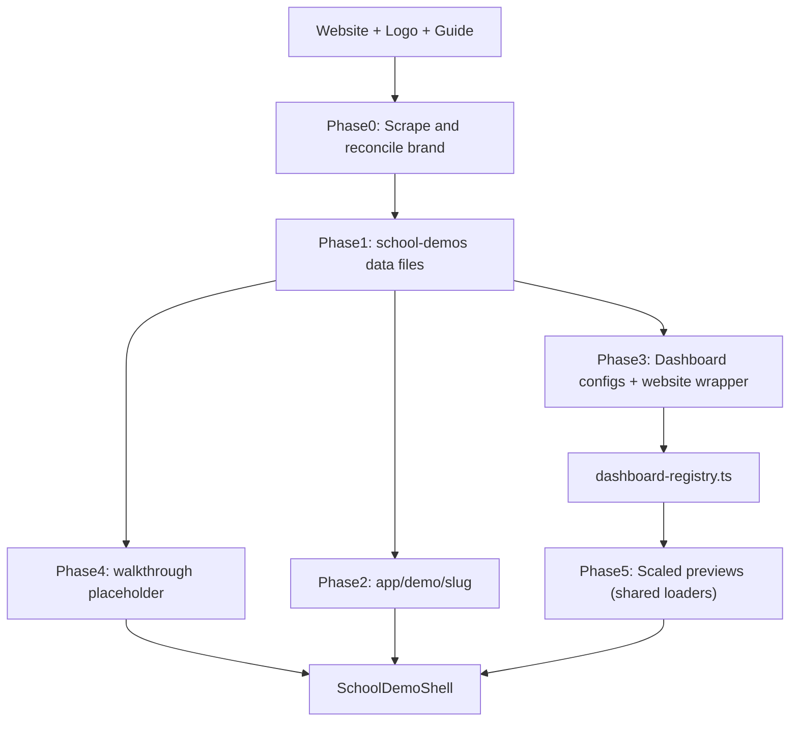

# School Demo Builder

Repeatable workflow for adding a new school demo at `/demo/{slug}`. Canonical reference: **Luff Learning** (`src/app/demo/luff-learning/`).

## Required inputs

Ask the user if any are missing:

| Input | Example |
|---|---|
| School name | Luff Learning Fine Arts Academy |
| Website URL | https://lufflearning.org/ |
| Logo path | `public/images/demo/lufflearning/Logo....png` |
| Redesign guide | `guides/demos/luff_learning_redesign_guide.md` |
| URL slug (optional) | `luff-learning` — derive kebab-case from name if omitted |

If no redesign guide exists, copy [redesign-guide-template.md](redesign-guide-template.md) to `guides/demos/{school}_redesign_guide.md`, scrape the site to fill it, then proceed.

## Architecture



## Phase 0 — Research (before coding)

1. Read the redesign guide — copy themes, programs, testimonials, FAQ, contact info.
2. Scrape the live site — homepage, programs, FAQ, events, stories; supplement guide gaps.
3. Reconcile brand colors — cross-check guide hex values against logo + live CSS. WP/Kadence scrapes often mislabel roles (e.g. `#efad1f` labeled "purple" but is gold). Then map them to the **Garden roles** the demo uses (see [reference.md](reference.md#color-reconciliation)):
   - `theme.dark` → the **action colour**: every CTA button, accent words in headings, and the one dark panel. It must read with white text (deep navy, forest, plum…). `readableOn()` in `site-garden-theme.ts` falls back to ink text for light colours, but a light `dark` makes the whole site look washed out — pick a dark brand colour.
   - `theme.primary` → the **brand tint**: sticky notes, washi tape and marker highlights (mixed with paper, so bright yellows/oranges work well).
4. Logo handling — the website nav and footer are light paper, so pick a logo that reads on light backgrounds (white/reverse logos need `logoOnLightClassName`, e.g. `brightness-0`). Set width/height in config.
5. Document live-site fonts in the redesign guide for **copy tone only**. Every demo uses the Garden fonts (Bricolage Grotesque display, Nunito body, a little Gochi Hand), applied by the website template's own scope (`SITE_SCOPE_CLASS` in `site-garden-theme.ts`) and by the real Garden portals. Copy `layout.tsx` from an existing demo unchanged; do not add per-school fonts.

## Phase 1 — Data layer

Create in `src/data/school-demos/`:

| File | Exports |
|---|---|
| `{slug}.ts` | `{camelCase}Config: SchoolWebsiteDemoConfig` |
| `{slug}-admin-demo.ts` | `*_LOGO`, `*_ADMIN_COLORS`, `*_ADMIN_COMPACT_ROWS`, `{camelCase}AdminDemoConfig` |
| `{slug}-parent-demo.ts` | Logo/colors constants + `{camelCase}ParentDemoConfig` |
| `{slug}-teacher-demo.ts` | `*_TEACHER_PROGRAM_LABELS`, `*_TEACHER_PROGRAM_ORDER`, `{camelCase}TeacherDemoConfig` |

Model `{slug}.ts` on `lighthouse-homeschool.ts` or `luff-learning.ts`. Register in `index.ts` (named export + registry key).

Export `*DemoConfig` objects typed from `demo-dashboard-types.ts` (see `luff-learning-admin-demo.ts`). Then register each config in `dashboard-registry.ts` under `schoolAdminDemoConfigs`, `schoolParentDemoConfigs`, and `schoolTeacherDemoConfigs`.

Website config must include: `theme`, `hero`, `signatureSection`, `stats`, `welcome`, `marquee`, `programs` (3–4 cards), `socialProof` (testimonials), `founder`, `form`, `faq`, `closingCta`, `footer`.

Testimonials must use `DemoTestimonial` shape — see [reference.md](reference.md#testimonial-shape).

## Phase 2 — App route

```
src/app/demo/{slug}/
  page.tsx   → SchoolDemoShell + config + walkthrough placeholder
  layout.tsx → SchoolDemoWebsiteFonts wrapper + pageMetadata (noIndex: true); copy as is
```

Copy from `src/app/demo/luff-learning/`.

## Phase 3 — Dashboard data (no TSX forks)

Shared portal UI: `src/components/demo/shared/School*DashboardDemo.tsx`.

Per school, export `*DemoConfig` from `{slug}-admin-demo.ts`, `{slug}-parent-demo.ts`, and `{slug}-teacher-demo.ts`, then register in `dashboard-registry.ts`.

**Optional admin mock overrides:** If leads, events, or emails should differ from the canonical Luff demo, add `src/data/school-demos/admin-content/{slug}.ts` and reference it from `SchoolAdminDemoConfig.contentOverrides` (see `lighthouse-homeschool` admin config). Do not edit the shared admin component for school-specific copy.

Component folder still needs `{Brand}WebsiteDashboardDemo.tsx` and `{Brand}MobileAppShowcase.tsx` only.

**Do not** fork admin/parent/teacher dashboard TSX — per-school forks caused Vercel build OOM. The walkthrough's portal steps render the **real Garden portals** from these configs (see Phase 3b).

Naming conventions: [reference.md](reference.md#naming-conventions).

## Phase 3b — Portal steps render the real Garden portals

Walkthrough steps 3–7 show the **real** school portal components (the same code families use), in `previewMode`, fed by demo fixtures. Nothing is fetched and the walkthrough URL is never written. Each school's colours and logo come from its admin/parent/teacher configs through the `apply*DemoRuntime` helpers.

| Step | Demo wrapper (`src/components/demo/shared/`) | Real components it renders |
|---|---|---|
| 3 view-lead, 4 send-application-link | `DemoAdminGardenAdmissions` (inside `DemoAdminGardenShell`) | `SchoolAdminBaseline` (Garden sidebar, preview mode) + `ApplicationSubmissionsPageShell` (`preview` prop) + `ApplicationSubmissionDetailPanel` (`previewDetail`), `StartEnrollmentModal` (preview) |
| 5 parent-enrollment | `DemoParentEnrollmentChecklist` | `ApplyPortalPageShell` + `EnrollmentChecklistExperience` (`mode="preview"`) |
| 6 parent-pays-tuition | `DemoParentGardenPortal` | `SchoolParentBaseline` (`embeddedPreview`) + `ParentBillingPageShell` (`initialPreviewData`) |
| 7 teacher-attendance | `DemoTeacherGardenPortal` | `SchoolTeacherHeader` (`embeddedPreview`) + `TeacherAttendancePage` (`initialRoster`, `syncDateToUrl={false}`) |

Fixtures live in `src/data/school-demos/demo-*-fixtures.ts` (`demo-admin-admissions-fixtures.ts`, `demo-admin-submission-detail-fixtures.ts`, `demo-parent-portal-fixtures.ts`, `demo-teacher-portal-fixtures.ts`). The demo attendance roster is always dated today.

Rules:
- **Keep the accent identical** across `{slug}-admin-demo.ts` (`colors.accent`), `{slug}-parent-demo.ts` and `{slug}-teacher-demo.ts` (`accent`), so all three portals share one school colour.
- Feed data through the real components' `previewMode` / `initial*` / preview props. **Never** stub `window.fetch` in a demo, and never import route files from `src/app/school/`.
- Need a new portal moment in the walkthrough? Add a preview seam to the **real** component (as `previewDetail`, `embeddedPreview` and `initialRoster` were added) — don't build a demo copy. Follow the portal's Garden skill: `admin-portal-garden-design`, `parent-portal-garden-design`, `teacher-portal-garden-design`.
- Dialogs and toasts must render inside the scaled preview card (`GDialog` `portalContainer`), not over the walkthrough page.
- Other admin walkthrough steps (committees, tuition, My School) still use the older Story `SchoolAdminDashboardDemo` from the same configs. **Rooted Meadows** keeps its own custom portal forks (`src/components/demo/rootedmeadows/`); don't copy that pattern.

## Phase 3c — Website step: school-branded Garden

The website preview (steps 1–2) is one shared template, `src/components/sections/WebsiteDashboardDemo.tsx` + `src/components/sections/website-demo/**`, styled in MudKitchen Garden with the school's colours (skill: `mudkitchen-garden-design`). New schools only add a config — no website TSX forks.

- **Theme:** `src/components/sections/website-demo/site-garden-theme.ts` — `siteGardenScopeStyle(theme)` maps the school `DemoTheme` onto the Garden tokens (`--sf-clay` = `theme.dark`, `--sf-butter` = `theme.primary` tint, …), `SITE_SCOPE_CLASS` turns on the Garden fonts, and `SITE_*` constants hold buttons, cards, type and tints.
- **Kit:** `src/components/sections/website-demo/garden/SiteKit.tsx` — `SiteSectionIntro`, `SiteReveal`, `SitePolaroid`, `SiteStickyNote`, `SitePill`, `SiteAccent`, `keepHyphenated`.
- **Sizes use container queries** (`@3xl/site`, `@5xl/site`, `cqw`): the site renders at 375 / 1024 / 1440 design widths inside a scaled frame, so viewport `lg:` breakpoints never match.
- **Motion:** framer `whileInView` via `SiteReveal`. Garden's GSAP `Reveal` / `Draw` watch the window, but the site scrolls inside its own container, so content would stay hidden.
- **Copy:** every string comes from the school config; handwritten notes are decorative only.
- **One dark panel** per page (`SitePhotoBand`, in `theme.dark`).
- Keep section ids `programs`, `welcome`, `form`, `faq` with `scroll-mt-[88px]`: the nav links and walkthrough step 2 (`inquire`, scroll to `form`) depend on them.
- Signature sections (`website-demo/*Section.tsx`) are chosen by `signatureSection.type`; reuse an existing type rather than adding a new section.

## Phase 4 — Walkthrough

Append `{camelCase}WalkthroughPlaceholder` to `src/data/school-demos/walkthrough-placeholder.ts` (9 steps with the mobile showcase, 8 without):

1. discover (website)
2. inquire (form)
3. view-lead (admin)
4. send-application-link (admin) — title **"Start enrollment"**: the real Accept → Start enrollment flow runs (`initialSelectedLeadId: "l0"`, `autoSendEnrollmentLink: true`)
5. parent-enrollment (parent)
6. parent-pays-tuition (parent)
7. teacher-attendance (teacher)
8. mobile-app (mobile) — only when the school has a mobile showcase
9. get-in-touch (contact)

Use `createMobileAppWalkthroughStep(theme)` for step 8 (before contact). Theme steps with school primary + accent colors. Copy structure from `luffLearningWalkthroughPlaceholder`.

## Phase 5 — Scaled preview wiring (required)

Register the school slug in:

- `src/data/school-demos/dashboard-registry.ts` — import and add to all three maps: `schoolAdminDemoConfigs`, `schoolParentDemoConfigs`, `schoolTeacherDemoConfigs`
- `src/components/demo/shared/lazySchoolWebsiteDemo.tsx` (`WEBSITE_DEMO_LOADERS` — if new website wrapper path)
- `src/components/demo/ScaledMobileAppPreview.tsx` (`MOBILE_SHOWCASE_LOADERS`)

Admin/parent/teacher `Scaled*` previews need **no per-school edits** once configs are in the registry — shared loaders resolve by `demoSlug`, and the previews route the admissions, enrollment, billing and attendance steps to the Garden wrappers (Phase 3b) automatically. **Rooted Meadows** is the only standard demo with custom dashboard forks (`src/components/demo/rootedmeadows/`). Sagefield is a separate customer demo — out of scope here.

## Phase 5b — Mobile showcase (required)

1. Create `src/components/demo/{folder}/{Brand}MobileAppShowcase.tsx` using shared `SchoolMobileAppShowcase` + `createMicroschoolMobileSlides` from `src/components/demo/mobile/`.
2. Pass school `ADMIN_COLORS.accent`, founder/guide name for messages, and optional `schoolName` for the admissions slide header.
3. Register slug in `MOBILE_SHOWCASE_LOADERS` inside `src/components/demo/ScaledMobileAppPreview.tsx`.

### Mobile slide requirements (5 tabs)

Microschool demos use **Parent · Admin · Teacher** tabs (not committees):

| Tab | Audience | Must include |
|---|---|---|
| Messages | Parent | Thread UI with teacher name, online indicator, unread badge |
| Tuition | Parent | Gradient balance card, child filter pills, invoice list, per-row Pay + Pay All, paid state |
| Admissions | Admin | Submission cards, flow/status filters, tags, tap-to-detail sheet with Send application link CTA |
| Attendance | Teacher | 8–10 students, day navigator, search, Present / Pickup / Absent action buttons per row |
| Students | Teacher | Full roster with avatars, status pills, guardian contact, expandable profile chips |

Shared data lives in `src/components/demo/mobile/mobileDemoData.ts`. Slide components live under `src/components/demo/mobile/slides/`.

## Phase 6 — Verify

- [ ] `npm run build` — route appears as `/demo/{slug}`
- [ ] Website step: headings in Bricolage (not Lora/Poppins), CTAs in the school's `theme.dark`, logo readable on the paper nav, testimonials render (correct shape)
- [ ] Website at 375 / 1024 / 1440 frame widths: no horizontal scroll inside the site; step 2 CTA scrolls to the form
- [ ] Step 3: the Garden admin sidebar + Submissions page in the school colour; the new application slides in and the counts tick up
- [ ] Step 4: the real drawer opens; Accept → Start enrollment dialog and "Enrollment started" toast stay inside the preview card
- [ ] Step 5: the Garden enrollment checklist ticks off items
- [ ] Step 6: the Garden parent header + Billing page
- [ ] Step 7: the Garden staff header + Attendance with "Today's roster"; teacher program labels match `{slug}-teacher-demo.ts`
- [ ] Step 8 (if present): mobile preview with school accent + hint tooltip
- [ ] Every step: no `/api` or `/rest/v1` requests, no console errors, and the URL only changes `?step=`
- [ ] Dev note: each step's chunk compiles on first load and can take ~30–40s in `next dev`; wait before calling it broken

## Usage example

User prompt:

> Build a demo for {School Name}. Website: {url}. Logo: {path}. Guide: {guides/demos/...md}

Follow phases 0–6. Mark todos if present. Run build before finishing.

## Out of scope

- Committing or opening PRs (unless user asks)
- Editing plan files
- Rewriting admin dashboard UI from scratch

## Additional resources

- [reference.md](reference.md) — naming table, file checklist, palette rules
- [redesign-guide-template.md](redesign-guide-template.md) — starter guide when none exists
